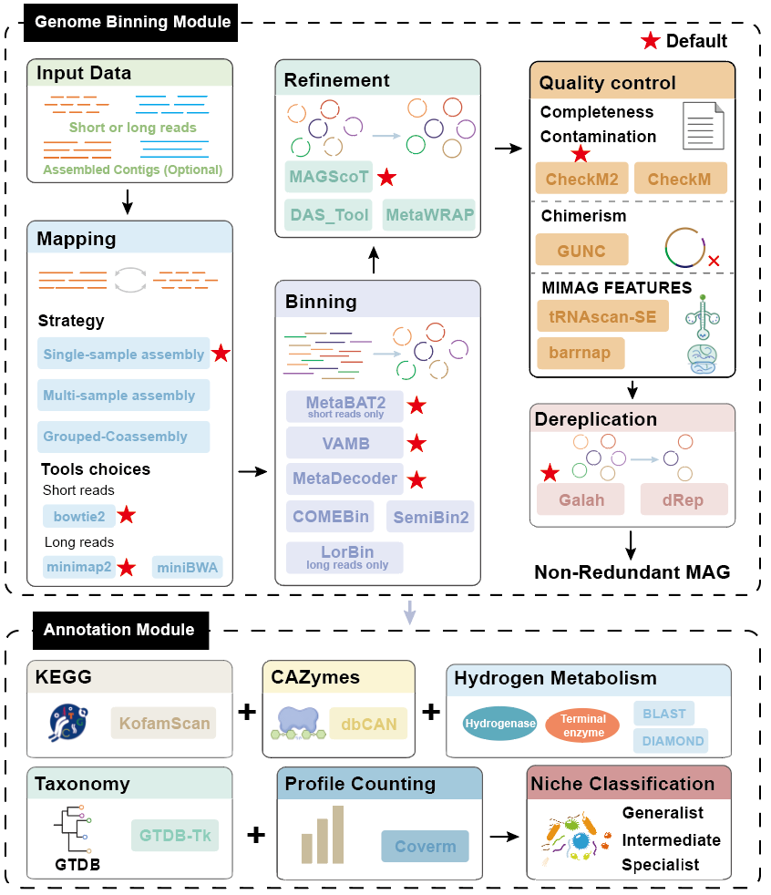

# 

<p align="justify">
Genome-resolved metagenomics requires coordination among tools for sequence mapping, contig binning, bin refinement, genome quality assessment, dereplication and downstream analysis. Differences in software environments, input formats, parameter settings and database requirements complicate workflow implementation and reproducibility. MetaBAW addresses this practical challenge by connecting these procedures within a unified workflow that accepts quality controlled sequencing reads and optional preassembled contigs. MetaBAW offers three complementary capabilities. First, it supports both short- and long-read inputs, accommodating different sequencing platform. Second, it enables single sample assembly, multi sample processing and grouped coassembly while integrating multiple complementary binning tools. Third, it combines MAG quality control and dereplication with taxonomic assignment, abundance profiling, functional annotation and niche classification, providing coordinated outputs for genome-resolved ecological analysis.
</p>

The workflow has three main modules:

- `metabaw bin`: assembly, read mapping, binning, bin refinement, MAG quality control and dereplication.
- `metabaw annotation`: taxonomy, MAG abundance, ecological niche classification, KEGG annotation, CAZy annotation, and hydrogen-metabolism annotation.
- `metabaw check`: check software, runtime environments and databases.

# 

## Contents

- [Quick start](#quick-start)
- [Requirements and installation](#requirements-and-installation)
- [Command help](#command-help)
- [Input files](#input-files)
- [Binning workflow](#binning-workflow)
- [Annotation workflow](#annotation-workflow)
- [Resource management](#resource-management)
- [Dependencies and databases](#dependencies-and-databases)
- [Reports, logs, and reproducibility](#reports-logs-and-reproducibility)
- [Temporary files and resume behavior](#temporary-files-and-resume-behavior)
- [Examples](#examples)
- [License](#license)

## Quick start

First [install MetaBAW](#requirements-and-installation) and configure the
[required software and databases](#dependencies-and-databases).

Run binning with the default read-type-specific binners, MAGScoT refinement,
CheckM2 quality assessment and Galah dereplication:

```bash
metabaw bin \
  --input_reads_files reads.tsv \
  --input_contig_files contigs.tsv \
  -t 64 --task 4 \
  -o metabaw_result
```

Omit `--input_contig_files` to assemble all samples from reads. In the default
assembly strategy, samples missing from a partial contig manifest are assembled
individually. For long reads, choose the appropriate Flye/Minimap2 input mode;
for example, add `--nano-hq` for high-quality ONT reads.


After binning succeeds, create an annotation input list from the final MAGs:

```bash
find -L "$(pwd)/metabaw_result/non_redundant_bins" \
  -maxdepth 1 -type f -name '*.fa' -print | LC_ALL=C sort > genomes.txt

metabaw annotation \
  --input_reads_files reads.tsv \
  --input_genome_files genomes.txt \
  -t 64 --task 4 \
  -o metabaw_annotation_result
```

This example uses the default MAG suffix `fa`; adjust the `find` pattern if
binning used another `--mag-suffix`. Absolute MAG paths avoid ambiguity when
moving the list. Annotation enables taxonomy, abundance and all three functional
annotation branches by default. Niche classification runs only with at least
four MAGs and four read samples. Newly generated GTDB-Tk classification requires
a configured memory budget of at least 160 GiB; this is a preflight floor, not
a prediction of peak memory. See [taxonomy and abundance](#taxonomy-and-abundance)
for reuse of existing taxonomy and ways to disable optional annotation branches.

## Requirements and installation

Use Linux, WSL2, or an HPC Linux environment for production runs. MetaBAW
requires Python 3.11. External bioinformatics programs and reference databases
are not bundled in the wheel.

Conda, Mamba or Micromamba is needed for the isolated tool environments.
[Miniforge](https://mamba.readthedocs.io/en/latest/installation/mamba-installation.html)
provides both Conda and Mamba. CPU execution is supported; NVIDIA GPUs
additionally require a working driver and compatible CUDA/PyTorch or CuPy
runtimes. Reserve adequate
RAM, database storage and temporary disk space for the selected tools. The
160 GiB GTDB-Tk classification floor does not apply to every binning task.

### Install a release wheel

Obtain `metabaw-0.1.0-py3-none-any.whl` and its matching `SHA256SUMS` from the
provided release distribution or the repository's Releases page, when available.
Keep both files in the same directory and verify the wheel before installation:

```bash
sha256sum -c SHA256SUMS
```

Create the main environment with Conda:

```bash
conda create -n metabaw python=3.11 pip "setuptools<82"
```

Alternatively, use Mamba from the same installation:

```bash
mamba create -n metabaw python=3.11 pip "setuptools<82"
```

After creating the environment with either command, activate it and install
the wheel:

```bash
conda activate metabaw
python -m pip install ./metabaw-0.1.0-py3-none-any.whl

metabaw --version
metabaw --help
```

For package transactions, `mamba create`, `mamba install` and `mamba update`
can replace the corresponding Conda commands while keeping the same environment,
package versions and channels. `conda activate` also works for environments
created by Mamba in the same installation. If your shell is initialized for
Mamba, you can use `mamba activate metabaw` instead. See the
[official Mamba user guide](https://mamba.readthedocs.io/en/latest/user_guide/mamba.html).
Install the MetaBAW wheel with `python -m pip install` as shown above.

To replace an existing installation of this edition:

```bash
python -m pip install --force-reinstall --no-deps \
  ./metabaw-0.1.0-py3-none-any.whl
```

`--no-deps` is appropriate only when the existing environment already satisfies
the package requirements. Installing a wheel does not install external
bioinformatics programs or their databases.

### Check dependencies

Check dependencies before the first analysis:

```bash
metabaw check --essential
metabaw check --scope bin
metabaw check --scope annotation
metabaw check --all
```

Use `metabaw check -h` to list database-path and environment options.

## Command help

```bash
metabaw -h                   # modules under "Module options"
metabaw bin -h               # core binning options, including --tools
metabaw bin --full-help      # all binning options
metabaw annotation -h        # all annotation options
metabaw check -h             # dependency and database options
```

Only `bin`, `annotation`, and `check` are accepted as subcommands.
The main help lists them under `Module options:`. The former `binning` and
`checking` names are not accepted. Help output is the complete parameter
reference; the tables below explain the most important options and constraints.

## Input files

All manifests are UTF-8 text files. Fields must be separated by a real tab
character, not spaces or the literal characters `\t`. Empty lines and lines
beginning with `#` are ignored. Relative paths are resolved against the
directory containing the manifest.

### Read manifest

`--input_reads_files` is required by both modules.

```text
#sample	reads
S1	/data/reads/S1_R1.fastq.gz,/data/reads/S1_R2.fastq.gz
S2	/data/reads/S2_R1.fastq.gz,/data/reads/S2_R2.fastq.gz
L1	/data/reads/L1.fastq.gz
```

- Two comma-separated files are interpreted as paired-end short reads in R1,
  R2 order.
- One file is interpreted as long reads.
- Supported extensions are `.fastq`, `.fq`, `.fastq.gz`, and `.fq.gz`.
- Paired files may use different compression formats.
- Sample names must be unique and begin with a letter or digit. Subsequent
  characters may be letters, digits, dots, underscores or hyphens.
- A one-file entry is not interpreted as single-end short reads. Do not combine
  short and long reads into one entry to request hybrid assembly; this edition
  distinguishes read type by the number of input files.

### Optional contig manifest

`--input_contig_files` is optional for binning.

```text
#sample	contigs
S1	/data/contigs/S1.fa
S2	/data/contigs/S2.fa.gz
L1	/data/contigs/L1.fasta
```

The sample name must exist in the read manifest. Supported FASTA extensions are
`.fa`, `.fna`, `.fasta`, and their gzip-compressed variants. A partial contig
manifest is valid: samples without supplied contigs are assembled automatically.

### Genome list for annotation

`--input_genome_files` contains one MAG FASTA path per line and has no sample
name column.

```text
# one MAG per line
/data/mags/MAG_001.fa
/data/mags/MAG_002.fna.gz
```

MAG basenames must be unique after the complete FASTA suffix is removed.
MetaBAW stages only listed MAGs and does not modify the original files.

### Coassembly manifest

A coassembly manifest has two tab-separated columns: sample and group.

```text
#sample	group
S1	group1
S2	group1
S3	group2
S4	group2
```

Each sample may occur once, and each group must contain at least two samples.
All samples in one group must have the same read type: all paired short reads or
all single-file long reads. Group names follow the same naming restrictions as
sample names. Different groups may use different read types.

### Grouped-coverage list

`--multi-files` accepts one existing sample name per line:

```text
S1
S2
S3
```

This mode cross-maps the listed reads to each listed sample assembly to obtain
multi-sample coverage. It does not coassemble the reads. Samples not listed in
the file remain independent. At least two distinct, known sample names are
required.

## Binning workflow

### Per-sample assembly and binning

The minimal command needs only a read manifest:

```bash
metabaw bin \
  --input_reads_files reads.tsv \
  -t 32 --task 2 \
  -o metabaw_result
```

Missing short-read assemblies are generated with MEGAHIT. Missing long-read
assemblies are generated with `flye --meta`. Flye input modes are mutually
exclusive:

```text
--pacbio-raw  --pacbio-corr  --pacbio-hifi
--nano-raw    --nano-corr    --nano-hq
```

The default long-read mode is `--nano-raw`. These options select the Flye input
mode and the matching Minimap2 preset; read paths still come from the read
manifest.

Generated per-sample contigs are written as:

```text
assemblies/<sample>/<sample>_contig_ok.fa
```

Contig identifiers use `<sample>_<number>`.

Existing contigs can be supplied explicitly:

```bash
metabaw bin \
  --input_reads_files reads.tsv \
  --input_contig_files contigs.tsv \
  --tools metabat2 metadecoder vamb comebin semibin2 \
  --refinement magscot \
  --quality-control checkm2 \
  --gunc --trna --rrna \
  --dereplication-tool galah \
  --con 10 --com 50 \
  -t 64 --task 4 \
  -o metabaw_result
```

Default mapping and binner selection depends on the read type:

| Read type | Default mapper | Default binners | Inapplicable requested binner |
|---|---|---|---|
| Paired short reads | Bowtie2 | MetaBAT2, MetaDecoder, VAMB | LorBin |
| Single-file long reads | Minimap2 | MetaDecoder, VAMB, LorBin | MetaBAT2 |

The complete binner set is MetaBAT2, MetaDecoder, VAMB, COMEBin, SemiBin2, and
LorBin. Explicitly requested but inapplicable binners are recorded in
`binner_summary.tsv`; they are not treated as execution failures.

### User-defined coassembly

```bash
metabaw bin \
  --input_reads_files reads.tsv \
  --assembly-strategy coassembly \
  --coassembly-file coassembly.tsv \
  --tools metabat2 metadecoder vamb comebin semibin2 \
  -t 64 --task 2 \
  -o metabaw_coassembly_result
```

Paired short-read groups are coassembled with MEGAHIT. Long-read groups are
coassembled with Flye. All group members are mapped separately to the group
assembly to provide differential coverage. Samples not present in the
coassembly manifest follow the normal per-sample workflow.

The coassembly FASTA is named:

```text
coassembly/assemblies/coassembly_<group>/<group>.contigs.ok.fa
```

Its sequence identifiers use `<group>_<number>`. Group bins use:

```text
<group>_<sample1>-<sample2>-..._<binner-or-refiner>_<number>.fa
```

`--assembly-strategy coassembly` requires `--coassembly-file` and cannot be
combined with `--multi-files`.

### Refinement and quality control

`04.export_refined_bins` exports the refined MAG FASTA files and their manifest
after `04.refine.<tool>`. For MAGScoT it extracts sequences using the refined
contig-to-bin mapping; for DAS Tool and MetaWRAP it normalizes their FASTA
exports. This is not another binning run and is not final `--tag-contigs`
renaming. Existing `04.bins.*` checkpoints remain compatible with the new name.

Important binning options include:

| Option | Meaning | Default |
|---|---|---|
| `--align-tool` | `bowtie2`, `minimap2`, or `minibwa`; omit for read-type-specific selection | short: `bowtie2`; long: `minimap2` |
| `--tools` | Applicable binners, separated by spaces or commas | read-type-specific set above |
| `--min-contig-length` | Minimum prepared contig length (bp) | `1500` |
| `--minfasta-kbs` | Minimum exported bin size (kilobases) | `200` |
| `--batch-size` | COMEBin training batch size | GPU: `1024`; CPU: `128` unless explicitly set |
| `--refinement` | `magscot`, `das_tool`, or `metawrap` | `magscot` |
| `--quality-control` | `checkm2` or `checkm` | `checkm2` |
| `--con` | Final QC maximum contamination (%) | `10` |
| `--com` | Final QC minimum completeness (%) | `50` |
| `--quality-score` | Minimum completeness (%) - 5 x contamination (%) | not set |
| `--dereplication-tool` | `galah` or `drep` | `galah` |
| `--ani` | Dereplication ANI (%) | `99` |
| `--min-aligned-fraction` | Minimum aligned fraction (%) | `30` |
| `--gunc` | Run GUNC chimerism/contamination checks | off |
| `--trna` / `--rrna` | Predict and report RNA genes | off |
| `--trna-pass N` | Require at least N distinct tRNA types; also enables prediction | not set |
| `--rrna-pass` | Require all three rRNA types: 5S, 16S and 23S; also enables prediction | off |
| `--environment` | SemiBin2 pretrained environment model; ignored unless SemiBin2 is selected | not set |
| `-x` / `--mag-suffix` | Output MAG suffix passed to downstream tools; not an input-contig format restriction | `fa` |
| `--tag-contigs` | Rename contigs in the final dereplicated MAGs as `<bin_name>_<number>` | off |
| `--retries` | Retries for eligible failed tasks; LorBin is excluded from automatic retry | `0` |
| `--advanced-arg TOOL=ARGS` | Repeatable expert arguments for a supported downstream tool | not set |

Bowtie2 cannot process long-read entries, and miniBWA cannot process paired
short-read entries. For mixed projects, omit `--align-tool` for per-sample
defaults or use Minimap2. `--environment` selects a SemiBin2 model, not a Conda
environment. `--tag-contigs` runs after dereplication (`07.tag_contigs`); it does
not change the preparation, mapping or binning contig IDs.

MetaWRAP accepts results from at most three applicable binning tools per
analysis. For example, use `--tools metadecoder vamb semibin2 --refinement
metawrap`. Select MAGScoT or DAS Tool when combining more than three binners.
MetaBAW rejects an oversized MetaWRAP selection before workflow tasks start.

Native refinement thresholds are distinct from the final quality filter:

| Refiner | Downstream quality estimation | Refinement completeness / contamination |
|---|---|---|
| MAGScoT | CheckM or CheckM2 | `--com` x 0.8 / `--con` x 1.2 |
| MetaWRAP | CheckM | Unchanged `--com` / `--con` |
| MetaWRAP | CheckM2 | `--com` x 0.8 / `--con` x 1.2 |
| DAS Tool | CheckM or CheckM2 | Native scoring settings unchanged; these two options are not forwarded |

The 20% adjustment is relative, not a change of 20 percentage points;
contamination is capped at 100%. For example, `--com 50 --con 10` gives
40%/12% for MAGScoT or MetaWRAP followed by CheckM2. Final selection uses the
user's original thresholds, inclusively: completeness >= `--com` and
contamination <= `--con` (50% and 10% in this example).
`--quality-score`, GUNC and RNA filter settings remain unchanged. MetaWRAP
still uses native CheckM during refinement; when CheckM2 is selected, MetaBAW
runs CheckM2 on the refined candidates for final quality assessment. When
CheckM is selected, MetaBAW reuses MetaWRAP's CheckM estimates.

MAGScoT receives the adjusted fractions through `--threshold` and
`--max_cont`; its native `--threshold` also affects score-based selection.
MetaWRAP receives adjusted percentages through `-c` and `-x`; its expected
bins directory and CheckM stats filename use these same effective values.
Startup logs and `run_manifest.json` record both refinement and final QC
thresholds. Changing refinement thresholds may trigger one refinement rerun;
unchanged upstream mapping, binning and marker searches remain reusable.

All three refiners can produce a valid zero-bin result. MetaBAW accepts it only
with tool-specific evidence: current scores and an explicit no-bin message for
MAGScoT; consistent native logs and bin evaluations for DAS Tool; or a successful
MetaWRAP exit, final bins directory and valid header-only final CheckM table.
Native failures, malformed tables and unexplained missing outputs still fail.

A validated empty sample contributes zero refined MAGs, has completion evidence
for resume, and does not stop other samples under `--failure-policy strict`.
Rejected source bins are never substituted into the catalogue and thresholds
are not relaxed further. Original bins remain under `bin_files/`. If all samples
are empty, collection stops with `No refined FASTA bins were collected` before
QC. Native MAGScoT output is also retained in
`<tmp>/work/refinement/<sample>/magscot.native.log`.

In `quality_control_files/rna_quality.tsv`, `pass` is `Not filtered` when
neither `--trna-pass` nor `--rrna-pass` is enabled. RNA predictions and tool
errors are still reported; this status does not claim that a MAG has complete
RNA genes. When at least one RNA filter is enabled, `pass` remains `true` or
`false` according to the requested filters only. Report-only results do not
exclude MAGs from downstream quality filtering.

`--failure-policy strict` is the default and stops new work after a required
binner chain fails. `--failure-policy best-effort` continues with other
successful binners.

### Binning output

Key output locations are:

```text
metabaw_result/
|-- assemblies/ or coassembly/assemblies/
|-- bin_files/<binner>/
|-- quality_control_files/
|-- non_redundant_bins/
|-- binner_summary.tsv
|-- workflow_details.md
|-- start_info.txt
|-- run_manifest.json
`-- tmp/
```

Independent bins use `<sample>_<binner-or-refiner>_<number>.fa`. Final
dereplicated MAGs are written under `non_redundant_bins/`.

`quality_control_files/quality_summary.tsv` retains every candidate's quality
assessment. Its `selected` column records quality-filter selection, while
`dereplication_pass` records the subsequent Galah/dRep representative selection:
`TRUE` for retained representatives, `FALSE` for quality-selected MAGs absent
from the representative catalogue, and `Not evaluated` for MAGs excluded before
dereplication. Quality-selected rows show `Pending` until the dereplication report
has completed; a failed dereplication is not reported as a completed rejection.
On resume, the report can update older summaries using existing representative
FASTAs without changing the binning or dereplication commands.

### Interpreting quality reports

`quality_control_files/candidate_bins/` contains all refined candidates;
`filtered_bins/` contains quality-selected MAGs before dereplication. The final
catalogue is `non_redundant_bins/`. A quality pass is not a dereplication pass.

| `quality_summary.tsv` column | Meaning |
|---|---|
| `bin` | Candidate MAG identifier without its FASTA suffix |
| `completeness`, `contamination` | Estimates in percent from the selected CheckM/CheckM2 assessment |
| `quality_score` | Completeness - 5 x contamination, in percentage-point units |
| `pass_gunc` | `true`, `false`, `unscored`, or `not_run` |
| `pass_rna` | Requested RNA-filter result: `true`, `false`, `Not filtered`, or `not_run` |
| `selected` | Whether the candidate passed the requested quality filters before dereplication |
| `reason` | `pass` or semicolon-separated reasons for exclusion, such as `low_completeness` or `gunc_failed` |
| `dereplication_pass` | `TRUE`, `FALSE`, `Not evaluated`, or `Pending`, as described above |

GUNC is optional, but `--gunc` applies its evaluable failures as a quality filter.
`unscored` means there is no usable pass/fail call: this includes reference
representation scores below 0.3, unavailable/invalid calls, or a missing MAG
entry in an otherwise populated GUNC summary. An evaluated MAG can therefore
have GUNC results yet remain `unscored`. By default it is not excluded solely
for that status; do not interpret it as a demonstrated GUNC pass. `not_run`
indicates that no populated GUNC results were used for the summary.

`rna_quality.tsv` reports `genome`, `domain`, `trna_types`, `rrna_5S`,
`rrna_16S`, `rrna_23S`, `pass`, and `error`. `trna_types` counts distinct types,
not total tRNA copies. Check the `error` field even in report-only mode. A MAG
passing the configured completeness/contamination filter is not automatically
a high-quality MIMAG genome; RNA and other applicable reporting criteria must
be assessed separately.

## Annotation workflow

Configure databases before the first annotation run:

```bash
metabaw check --scope annotation \
  --gtdbtk-db /db/gtdb/release232 \
  --kegg-db /db/kofam \
  --dbcan-db /db/dbcan \
  --hydrogenase-db /db/hydrogenase
```

All four values above are **database root directories**. They must contain the
unpacked files described in [Databases and reference assets](#databases-and-reference-assets).

Run annotation with the same read manifest used by binning and a MAG list:

```bash
metabaw annotation \
  --input_reads_files reads.tsv \
  --input_genome_files genomes.txt \
  --methods relative_abundance rpkm tpm mean \
  --niche-rank family \
  --niche_classify_method cv \
  --niche_abundance relative_abundance \
  -t 64 --task 4 \
  -o metabaw_annotation_result
```

The annotation module performs:

1. Taxonomic classification with GTDB-Tk.
2. MAG abundance profiling with CoverM.
3. Optional ecological niche classification.
4. Protein prediction with Prodigal.
5. KEGG Orthology annotation with KofamScan.
6. CAZyme annotation with run_dbCAN.
7. Hydrogenase annotation with HydDB searches.
8. Hydrogen-metabolism terminal-enzyme annotation with DIAMOND.

KEGG, CAZy, and hydrogen-metabolism annotation are enabled by default. Disable
them with `--no-kegg`, `--no-cazy`, or `--no-hyd`, respectively. `--no-hyd`
disables both hydrogenase and terminal-enzyme annotation.

The KEGG table retains each assigned KO in `Gene`. If an assigned KO has no
entry in the configured `K.descript.txt`, its `KO_gene_name` and
`KO_description` are both `NA`; the task log lists how many KO descriptions
were missing. A missing or invalid description file remains an error.

### Taxonomy and abundance

GTDB-Tk species placement is enabled by default and can be disabled with
`--no-place-species`, the only public species-placement switch.
A complete existing GTDB-Tk result can be reused with:

```bash
--gtdbtk_res /path/to/gtdbtk_result
```

MetaBAW validates that the supplied result contains one consistent
classification for every input MAG before skipping GTDB-Tk. `--gtdbtk_res` and
`--gtdbtk-db` are mutually exclusive.

Additional annotation controls include:

| Option | Meaning | Default |
|---|---|---|
| `--gtdbtk-tmpdir DIR` | Local parent for private GTDB-Tk IPC temporary files; must not be NFS | `/tmp` |
| `--output-file-suffix` | Suffix for abundance tables, not input MAGs | `.tsv` |
| `--retries` | Retries after an eligible task failure | `0` |
| `--no-niche` | Disable niche classification | off |
| `--no-kegg`, `--no-cazy`, `--no-hyd` | Disable the corresponding functional branches | off |

Supported abundance methods are:

```text
relative_abundance  rpkm  tpm  mean
```

Each read sample is profiled against all listed MAGs. Taxonomic ranks are added
to the merged abundance tables. CoverM uses 95% minimum read identity and 75%
minimum aligned read length. Relative abundance and mean coverage use a 10%
minimum covered genome fraction; RPKM, TPM and internal read counts use a
separate zero-covered-fraction pass because those estimators do not calculate
covered bases in the same way.

Relative abundance is expressed in percent, RPKM is reads per kilobase per
million reads, TPM is transcripts per million as implemented by CoverM for read
profiling, and `mean` is mean coverage depth. These are metagenomic read-based
metrics, not direct measurements of transcription. Only requested methods have
individual output matrices. A CoverM `unmapped` row is not a MAG and must be
excluded from genome counts.

### Niche classification

Niche classification runs only when the analysis contains at least four MAGs
and four read samples. Otherwise it is skipped without blocking other
annotation steps. Use `--no-niche` to disable it explicitly.

Two criteria are supported:

- `--niche_classify_method cv`: ranked CV quartiles (default).
- `--niche_classify_method occupancy`: sample-occupancy classification.

The default taxonomic rank is `family`, and the default abundance input is
`relative_abundance`. The selected niche abundance must also be included in
`--methods`. The decision, input counts, criterion, and abundance scale are
recorded in `niche_status.log` and niche provenance.

In `cv` mode, supported taxa at the selected rank are sorted by `raw_si_cv`
from low to high by default. Add `--cv-correct` to sort by `corrected_si`
instead. For taxon abundance values `a_1, ..., a_K` across all K samples,
including zeros, the raw CV is the sample standard deviation (denominator
`K - 1`) divided by the arithmetic mean. Abundances of MAGs assigned to the
same taxon are summed before calculating this statistic. A positive mean,
at least 20 total assigned reads and a finite selected CV are required for
ranking; CV mode does not impose a minimum occupancy.

The optional correction is `corrected_si = raw_si_cv - sqrt(K/R)`, where R is
the total read count assigned to that taxon across samples. R is the read-count
quantity called N in the diagnostic column `expected_si_bias_sqrt_K_over_N`;
it is not the number of taxa. Negative corrected values are retained, not
clipped to zero. Internal counts support this filter and correction but are
not an additional public abundance metric. Literature attribution and the
implemented MetaBAW rules are recorded separately in `niche/provenance.json`.
Taxon names in ascending order break exact ties in either mode.
For `n_taxa` supported taxa, the lowest `floor(n_taxa/4)` are `generalist`, the
highest `floor(n_taxa/4)` are `specialist`, and all remaining taxa are
`intermediate`. For example, 25 supported taxa produce 6/13/6 labels.
The rounding remainder belongs to the intermediate group; fewer than four
supported taxa therefore produce only intermediate labels. Low-support taxa
remain `unclassified_low_support` and are excluded from the ranked population.
Taxa with identical CVs can receive different labels at a rank boundary: this
is the explicit stable tie-breaking policy, not a difference in their CVs.

`--cv-correct` is disabled unless explicitly supplied and is valid only with
`--niche_classify_method cv`. Without this flag, `corrected_si` is diagnostic
only. `community_mean_corrected_si` never determines the classification.
Both `niche_classification.tsv` and `genome_to_taxon.tsv` include
`correct_cv_classification`: `TRUE` on every row when `--cv-correct` is used,
otherwise `FALSE`, including rows with insufficient support. The classification
table no longer includes `core_datasets`, `required_core_datasets`, or any
`prevalence::<dataset>` columns. Occupancy calculations retain their original
algorithm internally.

The table records the one-based `cv_quartile_rank` and observed tail-boundary
values of the selected raw or corrected CV; `provenance.json` records the
selected ranking value, population size, tail quotas, rounding and tie-breaking
policies.
These are relative labels within the supplied catalogue and sample cohort,
not independently validated absolute ecological categories. The equal-tail
group sizes follow the classification rule; they are not independent evidence
of ecological specialization.

In `occupancy` mode, a taxon is detected at a relative abundance of at least
0.01% and greater than zero in a sample. For other abundance metrics, detection
uses `100 x taxon abundance / total catalogue abundance` within each sample;
CV still uses the native selected metric. Eligible taxa need a positive mean,
at least 20 assigned reads and occupancy of at least 20% of samples. The current
CLI treats all samples as one dataset: occupancy >= 80% gives `generalist`,
otherwise `specialist`. This mode does not produce `intermediate`; use CV mode
for three-category classification.

Key `niche_classification.tsv` fields are:

| Field | Meaning |
|---|---|
| `taxon`, `rank`, `member_mags` | Taxonomic group, selected rank and number of contributing MAGs |
| `method`, `abundance_metric` | Classification criterion and selected abundance scale |
| `overall_occupancy` | Fraction of samples in which the taxon meets the detection threshold (0-1) |
| `total_reads` | Total assigned reads R, used for support and optional CV correction |
| `raw_si_cv` | Uncorrected CV; dimensionless, not a percentage |
| `expected_si_bias_sqrt_K_over_N` | The subtracted `sqrt(K/R)` correction term |
| `corrected_si` | Raw CV minus the correction term |
| `community_mean_corrected_si` | Mean finite corrected CV among supported taxa; diagnostic only |
| `correct_cv_classification` | Whether `--cv-correct` was selected (`TRUE`/`FALSE`) |
| `eligible`, `niche`, `reason` | Eligibility, assigned category and decision explanation |
| `cv_quartile_rank` | One-based position in the selected CV ranking; `NA` when not applicable |
| `cv_low_tail_max`, `cv_high_tail_min` | Observed CV values at the ranked tail boundaries, not interpolated percentile estimates |

The output retains the current `raw_si_cv` and `corrected_si` field names.
`genome_to_taxon.tsv` maps each MAG to its taxon and niche; `taxon_abundance.tsv`
contains the aggregated abundances and internal counts. These mappings do not
establish that every member MAG has the same independently measured niche.

All niche modes use versioned completion markers so resume regenerates old
table schemas instead of silently reusing them. Unchanged taxonomy and
abundance tasks can still be reused when their outputs exist. Changing
`--cv-correct` for an existing output directory is rejected, like changing the
niche method or abundance metric: use a new `-o` directory to keep both runs
and avoid stale classifications.

### Functional annotation outputs

Proteins are predicted once per MAG and mapped back to their source MAG and
contig. The principal functional tables are:

```text
kegg/kegg_annotations.tsv
cazy/cazy_annotations.tsv
hydrogenase/hydrogenase_annotations.tsv
terminal_enzymes/terminal_enzyme_annotations.tsv
```

The tables share stable MAG, contig, and gene identifier columns, followed by
method-specific evidence. Native combined-search output is retained for
provenance.

| Common column | Meaning |
|---|---|
| `MAG` | Source genome identifier |
| `MAG_contig_raw_id` | Contig identifier in the input MAG |
| `MAG_contig_id` | MAG-normalized contig identifier used for reporting |
| `MAG_contig_gene_id` | MAG-contig-gene identifier; use with `MAG` to count unique genes |
| `Gene` | Assigned KO, CAZyme label, hydrogenase type or terminal-enzyme class; not the unique gene identifier |

KEGG additionally reports `KO_gene_name` and `KO_description`; an assigned KO
with missing description fields remains an assignment. CAZyme evidence follows
the installed run_dbCAN output schema. Count genes using distinct
`(MAG, MAG_contig_gene_id)` pairs rather than annotation rows, and exclude
unassigned/`Unclassified` records when counting assigned functions. One gene
may have multiple assignments or occur in more than one annotation branch.

Hydrogenase searches use BLASTP against `hyddb.all.fa` with E-value <= `1e-50`,
then retain qualifying hits with identity >= 0.50 and query coverage >= 0.90.
`HydDB_subject` and `HydDB_group` identify the matched reference and its group.
`Gene` identifies the reported hydrogenase class (`NiFe`, `FeFe` or `Fe`).
FeFe candidates require an additional DIAMOND hit to `FeFe.dmnd` at the same
E-value cutoff; its evidence is reported in `FeFe_subject`, `FeFe_identity`,
`FeFe_evalue` and `FeFe_bitscore`. Those fields are blank for non-FeFe rows.

Terminal-enzyme searches use DIAMOND against `Terminal.dmnd`, E-value <=
`1e-50` and query coverage >= 0.80, followed by enzyme-specific identity cutoffs:

| Identity minimum | Enzyme classes |
|---|---|
| `0.80` | PsaA |
| `0.75` | HbsT |
| `0.70` | PsbA, IsoA, AtpA, YgfK, ARO |
| `0.60` | CoxL, MmoX, AmoA, NxrA, NuoF, RbcL, NiFe, FeFe, Fe |
| `0.40` | RHO |
| `0.50` | Other classes not listed above |

The best qualifying terminal-enzyme hit is retained per protein; `Reference`,
`Reference_title` and `Required_identity` expose the match and applied cutoff.

### Annotation output

```text
metabaw_annotation_result/
|-- gtdbtk_result/
|-- coverm/
|   |-- <sample>.tsv
|   |-- coverm_rel_abd.tsv
|   |-- coverm_rpkm_abd.tsv
|   |-- coverm_tpm_abd.tsv
|   |-- coverm_mean_abd.tsv
|   `-- coverm_all_metrics.tsv
|-- niche/
|   |-- niche_classification.tsv
|   |-- taxon_abundance.tsv
|   |-- genome_to_taxon.tsv
|   `-- provenance.json
|-- kegg/
|-- cazy/
|-- hydrogenase/
|-- terminal_enzymes/
|-- workflow_details.md
|-- start_info.txt
|-- niche_status.log
|-- run_manifest.json
`-- tmp/
```

## Resource management

### CPU scheduling

`-t/--threads` is the total workflow CPU budget. `--task` is the maximum number
of samples or MAGs processed concurrently. MetaBAW divides the total thread
budget across active sample slots; it does not multiply `-t` by `--task`.
CPU requests are limited to the permitted CPU affinity/cgroup-quota capacity.
The 80% safety ceiling applies to RAM and VRAM, not CPU threads.
This division applies to sample-level MEGAHIT/Flye assembly, mapping, binning and
refinement. After refined MAGs from all samples are collected, CheckM/CheckM2,
GUNC, GTDB-Tk domain identification, RNA QC and Galah/dRep use the full
effective workflow thread budget. For example, `--threads 128 --task 4`
allocates 32 threads per sample and 128 threads to each global QC or
dereplication task, provided the available CPU capacity permits 128 threads. Each global
task reserves that full budget, so global assessments do not each run with
128 threads simultaneously. RNA QC divides its global budget among candidate
MAGs, not original samples. Single-threaded collection, export and report
helpers still reserve one CPU. MetaWRAP with CheckM reuses its refinement
quality reports without a redundant global CheckM run.

Independent samples and distinct coassembly groups can assemble concurrently
up to `--task`. Each assembler uses its allocated sample thread/RAM share.
MEGAHIT's graph memory budget uses 90% of that RAM share, leaving room for
other allocations; the combined process-tree memory guard remains active.

### System memory

`--max-memory` is the combined workflow memory limit in GiB. Its default is the
detected machine memory, constrained by a smaller readable Linux cgroup limit.
For binning, requests exceeding 80% of currently available RAM are reduced
automatically. Available RAM is Linux `MemAvailable`, constrained by readable
cgroup memory headroom (`memory.max - memory.current`), not physical total RAM.
The resulting aggregate budget is divided equally across concurrent sample
slots. A cohort-wide task reserves the shared budget and waits for other
reservations to finish. External memory use can further reduce admission
budgets while the workflow runs. Annotation retains its existing total-limit
scheduling behavior.

### GPU execution

MetaBAW probes CUDA automatically. Use `--no-gpu` to force CPU execution.
`--max-gpu-memory` is now an **aggregate workflow VRAM request**, not a
per-task allowance. The default `100%` requests the combined physical VRAM of
visible GPUs; explicit sizes such as `16G` or percentages such as `50%` override
the request. MetaBAW caps it at 80% of current free VRAM and divides it equally
across sample slots. Each task is bound to one physical GPU using its UUID
when available. Several tasks may share a card if their reservations fit.
Every card also stays within its own 80%-of-free-VRAM ceiling. Equal shares
may be reduced further to fit heterogeneous cards: one process cannot pool
the memory of multiple GPUs. GPUs with unknown free VRAM are not used.

## Dependencies and databases

Only components required by the selected analysis are mandatory. Programs not
listed as isolated below must be executable on the active workflow `PATH`,
normally through the main `metabaw` environment. MetaBAW resolves the actual
launcher; an executable found in another environment is not assumed to use the
main Python runtime. Do not merge incompatible isolated environments into the
Python 3.11 main environment.

### Software and environments

For supported dependency installation and isolated-environment setup,
`metabaw check` automatically selects the first available manager on `PATH`
in this order: **Mamba, Micromamba, Conda**. Use managers from the same
installation, or select isolated environments by absolute prefix.
Keep `conda` available for MetaDecoder's automatic CuPy/CUDA runtime repair
and for saving GTDB-Tk's `GTDBTK_DATA_PATH` in the Conda environment; these
operations currently call Conda directly.

| Function | Programs | Environment / assets |
|---|---|---|
| Assembly | MEGAHIT; Flye (`--meta`) | Main environment / PATH; used only when assemblies must be generated |
| Mapping and BAM processing | Bowtie2, Minimap2, miniBWA, SAMtools | Main environment / PATH; mapper depends on read type |
| Binning | MetaBAT2, MetaDecoder, VAMB, SemiBin2 | Main environment / PATH; MetaDecoder GPU uses CuPy, other GPU branches use PyTorch |
| COMEBin binning | COMEBin and its auxiliary programs | Isolated `metabaw-comebin-py37` (Python 3.7) |
| Long-read binning | LorBin and its auxiliary programs | Isolated `metabaw-lorbin-py310` (Python 3.10) |
| Refinement | MAGScoT; DAS Tool | Main environment / PATH; native scripts and marker assets required |
| MetaWRAP refinement | MetaWRAP, including native CheckM | Isolated `metabaw-metawrap-py27` (Python 2.7); legacy CheckM reference data |
| Quality estimation | CheckM | Main environment / PATH; legacy CheckM reference data |
| Quality estimation | CheckM2 | Isolated `metabaw-checkm2-py312` (Python 3.12); CheckM2 DIAMOND database |
| Additional quality checks | GUNC, tRNAscan-SE, barrnap; GTDB-Tk domain identification | Main environment / PATH; GUNC and GTDB-Tk data as applicable |
| Dereplication | Galah with skani; dRep | Main environment / PATH; quality estimates supplied by MetaBAW |
| Taxonomy and abundance | GTDB-Tk, CoverM | Main environment / PATH; GTDB-Tk data unless existing taxonomy is supplied |
| Functional annotation | Prodigal, KofamScan, run_dbCAN, BLAST+, DIAMOND | Main environment / PATH; databases listed below |
| Supporting dependencies | HMMER (`hmmsearch`, `hmmalign`), Strobealign, Pullseq, pplacer/guppy, R and required R packages, Ruby, GNU Parallel, Bash | Required by their selected native tools; Git and build tools may also be needed for installation |

Choose isolated environments by name or absolute prefix with `check`:

```bash
metabaw check --comebin-env metabaw-comebin-py37
metabaw check --checkm2-env metabaw-checkm2-py312
metabaw check --metawrap-env metabaw-metawrap-py27
metabaw check --lorbin-env /shared/conda/envs/metabaw-lorbin-py310
```

An absolute prefix avoids ambiguity when multiple Conda installations contain
environments with the same name. The flags select and validate environments;
without `--scope`, `--all` or explicit `--essential`, only the explicitly
selected isolated tools are checked. These flags do not run an analysis.
If a LorBin environment has the wrong Python
version, approved repair preserves it and selects a compatible replacement.
`check --require-cuda` additionally requires usable selected GPU runtimes;
MetaDecoder is tested with CuPy independently of PyTorch in the main environment.

### Databases and reference assets

`metabaw check` validates database completeness and loading for its selected
profile and any explicitly supplied database paths. Use `--all` to include
optional legacy CheckM and GUNC databases. An incomplete database is reported
as `[MISSING]` with the failed file/load check, returns a nonzero exit status,
and is not saved as a validated path. Downloads requested with
`--install-databases` are rechecked before reporting `[OK]` or saving their
configuration.

Every `bin` and `annotation` invocation rechecks the databases used by its
selected modules before starting any workflow tasks, including resumed runs.
Missing, empty, unreadable or incomplete required assets are reported as
`[MISSING]` in the main output and recorded in `<output>/start_info.txt`; all
detected dependency failures are collected before the command exits.

**What to pass to each option**

These options are configured with `metabaw check`. A directory means the
unpacked database root containing the required files, rather than the downloaded
archive or one file inside that root. Replace `/db/...` and `/opt/...` with your
actual locations; the examples below are absolute Linux paths.

| Configuration flag | Input type | Example value |
|---|---|---|
| `--checkm-db` | Directory | `/db/checkm` |
| `--checkm2-db` | File: CheckM2 DIAMOND database | `/db/checkm2/CheckM2_database/uniref100.KO.1.dmnd` |
| `--gunc-db` | File: GUNC DIAMOND database | `/db/gunc/gunc_db_progenomes2.1.dmnd` |
| `--gtdbtk-db` | Directory: GTDB-Tk reference database | `/db/gtdb/release232` |
| `--kegg-db` | Directory: KOfam database containing both `ko_list` and `profiles/` | `/db/kofam` |
| `--dbcan-db` | Directory: run_dbCAN database | `/db/dbcan` |
| `--hydrogenase-db` | Directory: hydrogen-metabolism database | `/db/hydrogenase` |
| `--magscot-dir` | Directory: MAGScoT checkout containing its script and `hmm/` | `/opt/MAGScoT` |

CheckM2 and GUNC ultimately use an individual, nonempty `.dmnd` file. When given
a directory, MetaBAW searches it recursively and selects the first nonempty
`.dmnd` file in sorted path order. Prefer the explicit file path, especially if
several database releases are present. Unpack `.dmnd.gz` before configuration.
For GTDB-Tk, select the directory that directly contains `metadata/`, `taxonomy/`
and the other reference subdirectories, even if an archive creates an extra
parent directory.

`--database-dir`, for example `/db/metabaw`, is a **download destination
directory** used with `--install-databases`. Supported downloads go into its
`checkm2/`, `gunc/`, `gtdbtk/`, `kofam/` and `dbcan/` subdirectories; it is not the
argument value for every database option.

**Recommended downloads and required assets**

Download from the official source or the MetaBAW bundle linked below. Archive
names and `.dmnd` filenames can vary by release; use the actual unpacked name.

| Database / source | Required by | Minimum expected layout or file | Recommended download |
|---|---|---|---|
|CheckM| Standalone CheckM and MetaWRAP | `.dmanifest`, `hmms/phylo.hmm`, `hmms/checkm.hmm`, `pfam/Pfam-A.hmm.dat`, `genome_tree/`, `distributions/`, `selected_marker_sets.tsv`, `taxon_marker_sets.tsv` | [Official CheckM data mirror](https://data.ace.uq.edu.au/public/CheckM_databases/) or [CheckM reference archive on Zenodo](https://zenodo.org/records/7401545); e.g. `checkm_data_2015_01_16.tar.gz`, extracted into the selected root |
| CheckM2| CheckM2 | A nonempty `.dmnd` file, e.g. `uniref100.KO.1.dmnd` | [Official CheckM2 database instructions](https://github.com/chklovski/CheckM2#database) and [reference database v1.1.0 on Zenodo](https://zenodo.org/records/14897628); use the release matching your CheckM2 version |
| GUNC reference database | GUNC | A nonempty `.dmnd` file, e.g. `gunc_db_progenomes2.1.dmnd` | [Official GUNC download instructions](https://grp-bork.embl-community.io/gunc/installation.html#download-gunc-db) or [proGenomes 2.1 reference archive on Zenodo](https://zenodo.org/records/19631736); unpack `gunc_db_progenomes2.1.dmnd.gz` if downloaded manually |
| GTDB-Tk reference package | Taxonomy and RNA domain identification | `metadata/metadata.txt`, `taxonomy/gtdb_taxonomy.tsv`, `markers/`, `masks/`, `msa/`, `pplacer/`, `radii/` and ANI assets; new classification additionally requires `skani/` and `mrca_red/` | [Official GTDB-Tk reference instructions and compatibility table](https://ecogenomics.github.io/GTDBTk/installing/index.html#gtdb-tk-reference-data) and [R232 full-package download directory](https://data.gtdb.ecogenomic.org/releases/release232/232.0/auxillary_files/gtdbtk_package/full_package/); MetaBAW's GTDB-Tk 2.7.2 profile uses R232 |
| KEGG KOfam profiles and KO list | KofamScan | `ko_list`, nonempty `profiles/`, and usable `K.descript.txt` (locally derivable from `ko_list`) | [Official KOfam downloads](https://www.genome.jp/ftp/db/kofam/): [profiles.tar.gz](https://www.genome.jp/ftp/db/kofam/profiles.tar.gz) and [ko_list.gz](https://www.genome.jp/ftp/db/kofam/ko_list.gz) |
| dbCAN / CAZy reference bundle | run_dbCAN | `CAZy.dmnd`, `dbCAN.hmm` or `dbCAN.txt`, `dbCAN-sub.hmm` or `dbCAN_sub.hmm`, and `fam-substrate-mapping.tsv` | [Official run_dbCAN database download guide](https://run-dbcan.readthedocs.io/en/latest/user_guide/prepare_the_database.html), including HTTP and AWS S3 download addresses for each file |
| MetaBAW hydrogen-metabolism bundle, including HydDB references | Hydrogenase and terminal-enzyme searches | `hyddb.all.fa` (protein FASTA), `FeFe.dmnd`, `Terminal.dmnd`, `hyd_id-name.script.txt` | [XiangZhouCAS/Hydrogenase_db](https://github.com/XiangZhouCAS/Hydrogenase_db); original hydrogenase reference source: [GreeningLab/HydDB](https://github.com/GreeningLab/HydDB) |
| Native MAGScoT scripts and marker HMMs | MAGScoT | `MAGScoT.R`, `hmm/gtdbtk_rel207_Pfam-A.hmm`, `hmm/gtdbtk_rel207_tigrfam.hmm` | [Official MAGScoT repository](https://github.com/ikmb/MAGScoT); obtain the script and bundled marker HMMs together |

For KOfam, extract `profiles.tar.gz` into the database root and decompress
`ko_list.gz` to `ko_list`. Point `--kegg-db` at the parent of `profiles/`, for
example `/db/kofam`. MetaBAW can generate a missing `K.descript.txt` from the
`knum` and `definition` columns of `ko_list` during `check`; that database root
must be writable when this file needs to be generated.

For dbCAN, the official downloader prepares the required files together:

```bash
run_dbcan database --db_dir /db/dbcan --aws_s3 --no-cgc
metabaw check --scope annotation --dbcan-db /db/dbcan
```

`--dbcan-db /db/dbcan` selects the whole bundle, including both HMM collections
and the substrate mapping table; `CAZy.dmnd` is one file inside that directory.

**Hydrogenase download and attribution**

Download the MetaBAW-ready hydrogenase and terminal-enzyme bundle from
[XiangZhouCAS/Hydrogenase_db](https://github.com/XiangZhouCAS/Hydrogenase_db).
The underlying hydrogenase reference sequences originate from
[GreeningLab/HydDB](https://github.com/GreeningLab/HydDB); credit that original
source when using these references.

The repository distributes `Terminal.dmnd.gz`. Decompress it before using
MetaBAW, keeping the filename `Terminal.dmnd`:

```bash
git clone https://github.com/XiangZhouCAS/Hydrogenase_db.git /db/hydrogenase
gunzip /db/hydrogenase/Terminal.dmnd.gz
metabaw check --scope annotation --hydrogenase-db /db/hydrogenase
```

The directory passed to `--hydrogenase-db` must directly contain:

```text
/db/hydrogenase/
|-- hyddb.all.fa
|-- FeFe.dmnd
|-- Terminal.dmnd
|-- hyd_id-name.script.txt
```

Keep these four files together. The workflow builds its BLAST index from
`hyddb.all.fa` in the temporary workspace.

Configure existing binning databases, then enable optional components as needed:

```bash
metabaw check --scope bin \
  --checkm2-db /db/checkm2/CheckM2_database/uniref100.KO.1.dmnd \
  --magscot-dir /opt/MAGScoT

metabaw check --all --checkm-db /db/checkm
metabaw check --all \
  --gunc-db /db/gunc/gunc_db_progenomes2.1.dmnd \
  --gtdbtk-db /db/gtdb/release232
```

Use `check --all` only when preparing the full toolset: it checks components
not necessarily used by your intended run and may prompt for their installation.
To download only supported missing databases in a selected profile:

```bash
metabaw check --scope annotation --install-databases \
  --database-dir /db/metabaw \
  --hydrogenase-db /db/hydrogenase
```

The hydrogen-metabolism bundle must already exist at `/db/hydrogenase` in this
example. Downloaded
releases are not guaranteed to match an earlier analysis; record and retain the
actual reference version instead of silently replacing a database in place.

### Saved configuration and precedence

Database paths are saved in `~/.config/metabaw/databases.json`. Runtime
environment names/prefixes and the MAGScoT directory are saved in
`~/.config/metabaw/config.json`, unless `XDG_CONFIG_HOME` or
`METABAW_CONFIG_FILE` relocates that runtime configuration. Database configuration
does not use those runtime-config overrides.

| Database | Environment-variable alternative |
|---|---|
| CheckM | `CHECKM_DATA_PATH` |
| CheckM2 | `CHECKM2DB` |
| GUNC | `GUNC_DB` |
| GTDB-Tk | `GTDBTK_DATA_PATH` |
| KOfam | `KOFAM_DB` |
| dbCAN | `DBCAN_DB` |
| Hydrogen metabolism | `HYDROGENASE_DB` |

Environment variables use the same input types as the corresponding flags:
`CHECKM2DB` and `GUNC_DB` preferably point to the actual `.dmnd` files; the
other database variables point to their unpacked database root directories.

Explicit database arguments take precedence. Otherwise, a valid environment
variable is preferred to a saved path; an invalid environment path can fall
back to valid saved configuration with a warning. Most database-path flags
belong to `check`, not `bin` or `annotation`; annotation additionally accepts
`--gtdbtk-db` directly. Configure other paths before starting the workflow.

For isolated environments, `METABAW_COMEBIN_ENV`, `METABAW_CHECKM2_ENV`,
`METABAW_METAWRAP_ENV` and `METABAW_LORBIN_ENV` override saved settings, which
override default names. MAGScoT uses `MAGSCOT_DIR`, then its saved directory,
then `~/.cache/metabaw/MAGScoT`. Update or unset stale overrides when adopting
new configuration. `check` reports where settings were saved; configuration is
user-specific and is not automatically transferred by copying an output folder.

## Reports, logs, and reproducibility

Each run creates a compact set of audit files in the result directory:

- `workflow_details.md`: human-readable numbered workflow steps, software, and
  key parameters selected for the run.
- `start_info.txt`: command, sample configuration, dependency checks, CUDA
  status, resource budgets, warnings, and failure policy. Repeated starts append
  timestamped records.
- `run_manifest.json`: machine-readable inputs, checksums, resolved workflow
  plan, task commands, dependencies, database paths, software versions, and
  source fingerprint.
- `binner_summary.tsv`: per-target binner eligibility, completion, failure, and
  output information for binning runs.

Internal execution reports are kept with temporary files, not final results:

- `<tmp>/runtime/workflow_summary.json`: final workflow status and task counts.
- `<tmp>/runtime/memory_diagnostics.jsonl`: created only when memory accounting
  is degraded, a process has no readable address space, or a memory breach is
  suspected.
- `<tmp>/runtime/logs/`: one detailed log per workflow task.
- `<tmp>/runtime/resume_diagnostics.json`: reuse/rerun decisions and invalidated
  data dependencies from the latest startup scan; not a final-result report.

`workflow_details.md` describes the planned methods. Use the `execution` section
of `run_manifest.json` or the temporary summary and task logs to determine
completion status. On resume, reports left at the top level by older releases
are moved into the runtime directory; existing diagnostic history is preserved.

## Temporary files and resume behavior

The default temporary directory is `<output>/tmp`. A relative custom path is
created under the output directory; an absolute path is used directly.

```text
<tmp>/
|-- work/
|-- system_tmp/
`-- runtime/
    |-- state.sqlite3
    |-- workflow_summary.json
    |-- memory_diagnostics.jsonl  (only when needed)
    |-- resume_diagnostics.json
    `-- logs/
```

Temporary files are retained by default. `--delete-tmp-files` removes them only
after a successful workflow, including the two internal execution reports.
Failed runs retain intermediates and logs.

Restart an interrupted workflow using the same output and temporary directory,
or a complete copied/renamed workflow directory. Stop the original run before
copying its files. Keep `tmp/work`, `tmp/runtime/state.sqlite3`, the task logs
and `run_manifest.json`; then rerun the command with `-o` pointing to the copy.
No additional resume flag is required. For an absolute external `--tmp-files`,
retain that workspace or copy it too and specify its new absolute location.
Do not run two workflows against the same temporary workspace/state database.

Output/temp roots are normalized in portable checkpoints. A directory-name
change does not rebuild complete indexes, BAMs or bins. Copied generated-file
timestamps are not identity checks in portable resume: their producer tasks,
analysis settings, data dependencies and complete expected outputs determine
reuse. External input paths, sizes and modification times remain checked.
Internal absolute symlinks and SQLite log locators are rebased into the copied
tree; external input/database links, sequence data and historical log contents
are not rewritten. Relative internal links remain relative. The original run
is not modified. `[RESUME]` reports `relocated` cache hits.

Resume decisions distinguish runtime resources from analysis settings:

| Change or condition | Resume behavior |
|---|---|
| `--threads`, `--task`, RAM/VRAM budgets or supported native CPU-thread controls | Completed compatible tasks can be reused; unfinished tasks use the new budgets |
| Complete output/temp directory copied or renamed | Portable checkpoints normalize roots and repair internal links; external inputs remain checked |
| Main MetaBAW Python location or Conda frontend moved | Managed helper launchers are normalized; selected tool environments and upstream executable paths remain checked |
| Inputs, databases, mapper presets, quality thresholds, clustering options or CPU/GPU mode changed | Affected tasks and their data-dependent descendants rerun |
| Failed/interrupted task or incomplete/missing outputs | Task reruns; files alone are not evidence of successful completion |
| Niche method, abundance metric or `--cv-correct` changed in an annotation output directory | Startup rejects the changed configuration; use a new `-o` directory |

## Examples

Current manifest and command examples are provided under `examples/`:

```text
examples/reads.tsv.example
examples/contigs.tsv.example
examples/genomes.txt.example
examples/multi.txt.example
examples/run.sh
examples/run.coassembly.sh
examples/run.annotation.sh
```

## License

MetaBAW is distributed under the MIT License. See [LICENSE](LICENSE). External
programs and reference databases retain their own licenses and usage terms.
